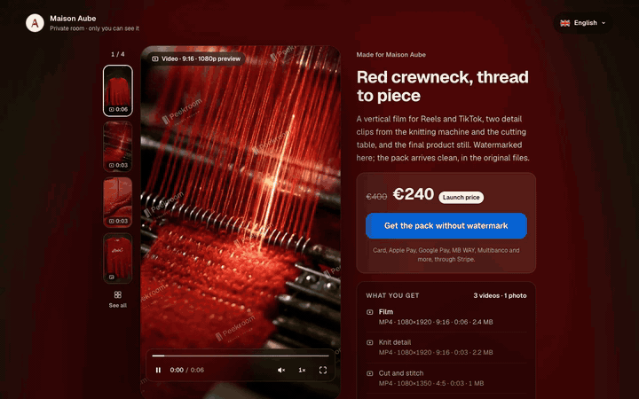
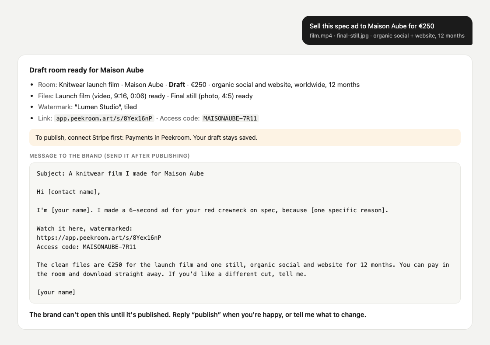
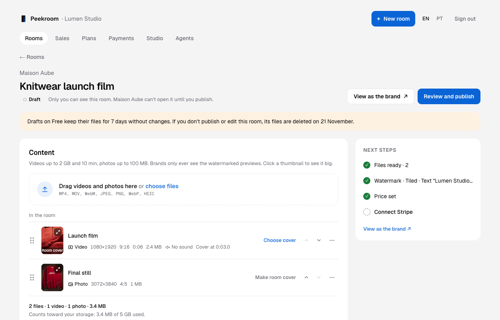
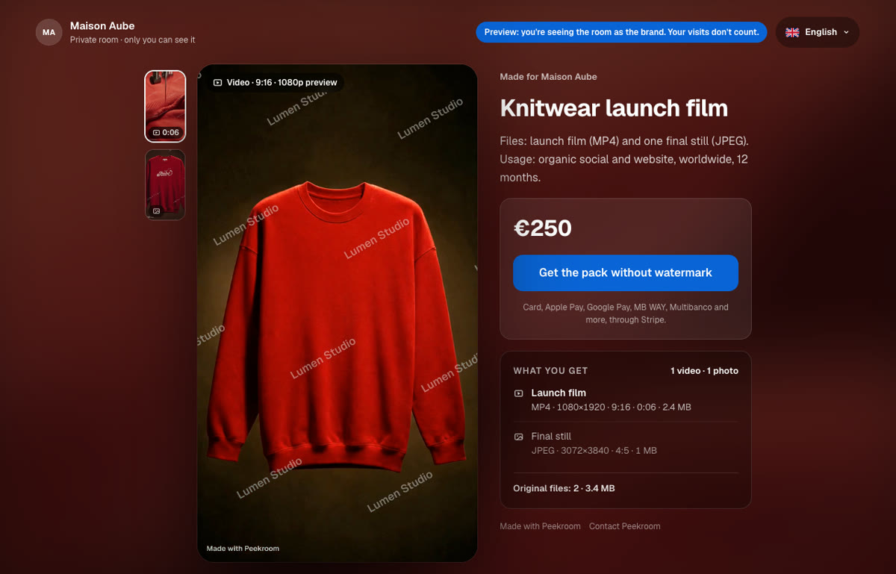
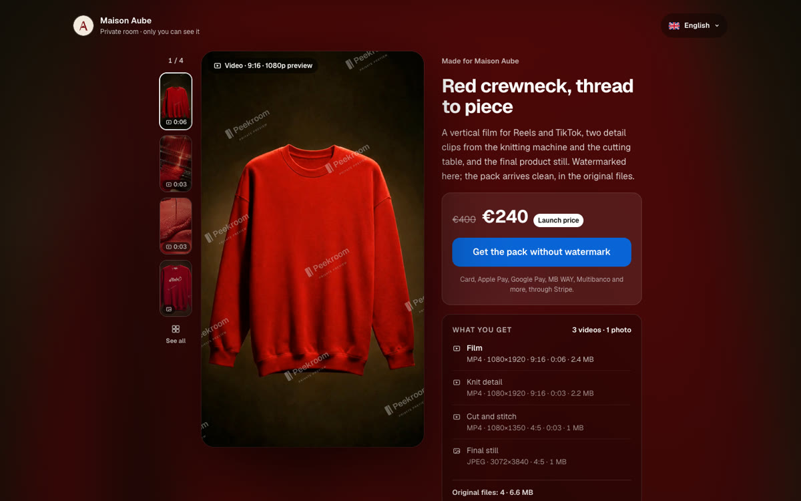

# Sell your AI spec ad to the brand you made it for

You made a film for a brand that never asked for it. This skill puts it in a private room with your watermark and a price, then hands you the message to send. The brand watches, pays in the room, and downloads the clean files.

```bash
npx skills add peekroom/skills
```

Then connect Peekroom so your assistant can build the room (Claude Code shown; [other apps](https://www.peekroom.art/agents)):

```bash
claude mcp add --transport http peekroom https://app.peekroom.art/mcp
```

[](https://app.peekroom.art/s/maisonaube)

*What the brand sees. [Open the live demo room](https://app.peekroom.art/s/maisonaube).*

## How it works

1. **Ask.** "Sell this spec ad to Maison Aube for €250", with your files.
2. **Check the draft.** Your assistant creates the room, uploads the files, sets your watermark and price, and shows you the link, the access code and a message to the brand. Nothing is public yet.
3. **Say "publish", then send it yourself.** The brand opens the room with the code, watches the watermarked cut, pays, and gets the originals. You see when they open it.

The skill never publishes until you say "publish", and it has no way to contact the brand. You send the message.

## A real run

Request, with `film.mp4` and `final-still.jpg` from a local folder:

> Sell this spec ad to Maison Aube for €250. Organic social and website, 12 months.

What came back (from a test on the live app):



Behind that reply, the assistant called `create_room`, `upload_asset` and `confirm_upload` for each file, `list_rooms` to wait for the previews, and `get_room_link`. The test studio had no Stripe account yet, so when we said "publish", Peekroom refused and the skill explained where to connect it. The draft stayed saved.

| Your editor | The draft, seen as the brand |
|---|---|
|  |  |

## What Peekroom is

Private rooms for selling creative work to brands. They preview everything watermarked and pay through Stripe to unlock the originals.

Peekroom's fee per sale: **5% on Free, 3% on Pro, 0% on Studio**. Your first sale has no Peekroom fee on any plan. Stripe's card fees are separate.

[](https://app.peekroom.art/s/maisonaube)

## Other ways to install

**Claude Code plugin** (skill and connector in one step):

```
/plugin marketplace add peekroom/skills
/plugin install sell-ai-spec-ad@peekroom
```

**One skill, one agent, no prompts:**

```bash
npx skills add peekroom/skills --skill sell-ai-spec-ad --agent claude-code -y
```

Add `-g` to install it for your user instead of the current project. `npx skills add peekroom/skills --list` shows what's in this repo.

**Claude on the web or desktop:** download [`sell-ai-spec-ad.zip`](https://www.peekroom.art/sell-your-ai-spec-ad), upload it under Settings → Skills, and add the connector under Settings → Connectors → Add custom connector with the URL `https://app.peekroom.art/mcp`.

**ChatGPT, Cursor, Gemini or scripts:** see [peekroom.art/agents](https://www.peekroom.art/agents).

## Skills in this repo

| Skill | What it does |
|---|---|
| [`sell-ai-spec-ad`](sell-ai-spec-ad/) | Turns a finished AI spec ad into a private, watermarked room with a price, and drafts the message to the brand. |

## Links

- [peekroom.art](https://www.peekroom.art)
- [Guide: sell your AI spec ad](https://www.peekroom.art/sell-your-ai-spec-ad)
- [Connect an AI agent](https://www.peekroom.art/agents)
- [Demo room](https://app.peekroom.art/s/maisonaube)

MIT licence. Questions: hello@peekroom.art
