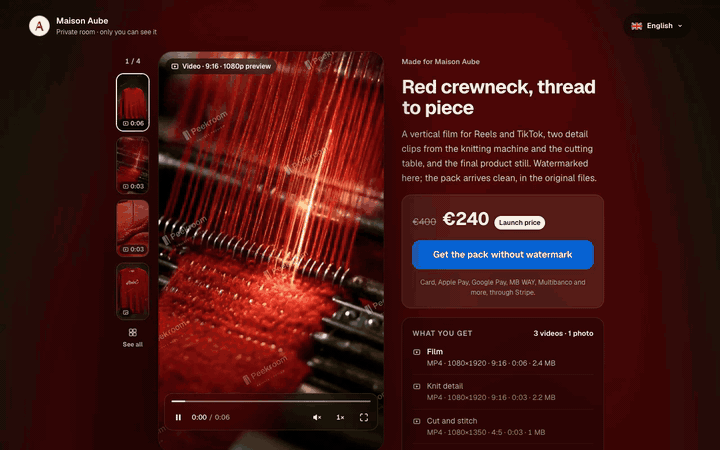

# sell-ai-spec-ad

Turns a finished AI spec ad into a private, watermarked Peekroom room with a price, and drafts the message to the brand. It builds a draft and stops there: it publishes only when you say "publish", and it never contacts the brand.



## Install

```bash
npx skills add peekroom/skills --skill sell-ai-spec-ad
```

Connect Peekroom so the skill can build rooms. In Claude Code:

```bash
claude mcp add --transport http peekroom https://app.peekroom.art/mcp
```

Then run `/mcp` to sign in. Claude Code plugin with both at once: `/plugin marketplace add peekroom/skills`, then `/plugin install sell-ai-spec-ad@peekroom`.

Claude on the web or desktop: zip this folder (or download it from [the guide](https://www.peekroom.art/sell-your-ai-spec-ad)), upload it under Settings → Skills, and add the connector under Settings → Connectors → Add custom connector, URL `https://app.peekroom.art/mcp`. Other apps: [peekroom.art/agents](https://www.peekroom.art/agents).

## Try

"Sell this spec ad to Maison Aube for €250", with your video and photos as local files or download links.

You get back a draft room, its link and access code, and a message to paste to the brand. Reply "publish" when you're ready. Publishing needs Stripe connected in Peekroom (Payments); the skill tells you if it isn't.

MIT licence. Made by [Peekroom](https://www.peekroom.art).
